# MORSE for the M-VAVE FM-1

A pocket Morse code machine for the [M-VAVE FM-1](https://www.m-vave.com/), built on
[fm1-base](https://github.com/charlesvestal/fm1-base). Key on the piano keys and read what you
sent, drill short and long presses, learn the code by sound with flash cards, listen to endless
practice, type letters and CW phrases on the keys. GPL-3.0-or-later.

**[MORSE on the web](https://daviddwlee84.github.io/fm1-morse/web/)**: see what your FM-1 reads, send it
text to copy, back up and restore your progress. Chrome or Edge, the FM-1 on USB or Bluetooth, nothing to install.
No FM-1 at hand? **[Try it in the browser](https://daviddwlee84.github.io/fm1-morse/web/try/)** (the
[fm1-emu](https://github.com/joakimeriksson/fm1-emu) emulator). Every page and button on one sheet:
**[cheatsheet](https://daviddwlee84.github.io/fm1-morse/web/cheatsheet.html)**.

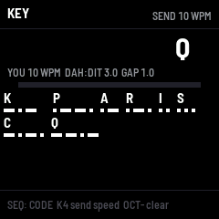

## What it does

| Page | What |
|---|---|
| **PRACTICE** | Flash cards a few minutes at a time. Two cards per letter (recognise it, send it), each in a Leitner box; new letters five at a time in Koch order. The schedule counts rounds, not days (the FM-1 keeps no clock through a power-off). Learning **by sound** is the default: no dots and dashes on the screen. A keyed answer is judged by its own rhythm (a dah about three dits), at whatever speed your hand goes, with a grade, the letter as it goes over the letter as you keyed it, and what to work on; a near miss counts as *almost* and comes back. A placement test skips the letters you already know. |
| **LISTEN** | Plays on and on: Koch groups of the letters you have, common words, a made-up QSO, CW abbreviations with their meaning, sayings. Shown as it plays, or hidden for copying. |
| **KEY** | Key freely and read what you sent: as text, as each letter over the dits and dahs you keyed, or as bars to scale. Your speed, dah:dit ratio and the gaps inside letters. |
| **RHYTHM** | Drills of short and long presses against the target length, a judgement for each press, a hint, and a send speed that fits your hand. |
| **TYPE** | The keys are letters, digits and signs, or CW phrases and prosigns (`CQ`, `<SK>`, `73`...). Each key plays at once, or compose a line and send it. |
| **CHART** | The course as a grid, coloured by how well you know each letter, or (`SEQ`, 0.9) by how often you missed it. The footer counts the letter's misses; a dot marks a letter missed often lately, which comes back sooner than its level says. Edit it by hand (a letter's level, the groups open, all one step back, all reset); nothing is written until you confirm. |

A straight key (any key) or iambic A/B paddles (left half dit, right half dah). A sidetone at your
pitch, received signals a third higher, or silence and the key lights. Hearing and sending have
their own speeds: Koch wants the characters heard fast, a beginner's hand is slow.

Keying goes out and comes in over USB-MIDI or Bluetooth MIDI as note 0 on channel 1, the
[Vail adapter's format](https://github.com/Vail-CW/vail-adapter/blob/master/docs/MIDI_INTEGRATION_SPEC.md),
so [Vail](https://vailmorse.com/) and its training tools take it. A host program
([`host/morse`](https://github.com/daviddwlee84/M-VAVE_FM-1/tree/main/host/morse)) types what you
send into the computer and sends text for the FM-1 to play.

## Controls

The whole set on one printable page: **[cheatsheet](https://daviddwlee84.github.io/fm1-morse/web/cheatsheet.html)**.
MORSE starts on the menu (SETTINGS > START PAGE picks another page; up to 0.6 it started on PRACTICE).

| Control | Anywhere |
|---|---|
| `HOME` | the menu (again: back) |
| `ALGO` | the next page |
| `SAVE` | save the settings now (else 3 s after the last change; lit, and `*` after the page's name, until then) |
| `FX` | sound on / off (off: read the key lights) |
| `K1`, `K2` | hearing speed, and the spacing between letters (Farnsworth) |
| `K3` | pitch |
| `K4` | sending speed: the keyer, the decoder's start, the RHYTHM target |
| `MASTER` | volume |

| Page | Controls |
|---|---|
| PRACTICE | `PLAY` start / again (a new letter too); `SEQ` a peek at the code of a new letter or an answer (learning by sound); `SELECT` on the start page: a round or a placement test; `E4` `F4` `G4` `A4` (lit) pick one of four, or `SELECT` + `SEL`; key the cards that ask for it; `SEL` don't know |
| LISTEN | `PLAY` start / stop; `SELECT` program; `SEQ` show / hide; `SEL` peek |
| KEY | `SEQ` view (text, code, timing); `OCT-` clear |
| RHYTHM | `SELECT` drill; `PLAY` start again |
| TYPE | `OCT-` / `OCT+` page (letters, digits and signs, phrases); `REC` delete, held: clear; `PLAY` play / stop; `SEL` live / compose; `SEQ` the code on the keys |
| CHART | `SELECT` move; `PLAY` hear it; `SEQ` colour by level / by misses; `REC` edit: `OCT-` / `OCT+` or `K1` the letter's level (0 = new again), `K2` groups open, `FX` all one box back, `SEL` held 2 s all reset; `PLAY` or `REC` then asks *SAVE CHANGES?* (`PLAY` yes, `HOME` no) |
| SETTINGS | `SELECT` item; `OCT-` / `OCT+` change. START PAGE: the page it starts on (MENU by default). PRESET sets the speeds together: START (hear 20/8, send 10), BUILDING, QSO, FAST. JUDGING: by rhythm (default) or strict (the decoder at the send speed, as up to 0.3) |

Any question on the screen about your progress (save an edit, mark what a test found, load a
backup) is answered only by `PLAY` (yes) or `HOME` (no); every other key is ignored while it asks.

A longer guide (Traditional Chinese):
[learning with MORSE](https://daviddwlee84.github.io/M-VAVE_FM-1/dev/morse-learn/),
[design](https://daviddwlee84.github.io/M-VAVE_FM-1/dev/morse/),
[cheatsheet](https://daviddwlee84.github.io/M-VAVE_FM-1/dev/morse-cheatsheet/).

## Learning with MORSE

1. **Settings → PRESET START** (hear 20/8, send 10). Characters are played fast and the gaps
   stretched, so each letter is one sound to recognise, not dots to count.
2. **PRACTICE, one round a day** (2-5 minutes). New letters come five at a time once the open ones
   are learnt: each recognised right in two rounds, and sent right once. The start page says which
   letters the next group waits on.
3. **Key the cards back in the rhythm you heard.** Speed does not matter; the ratio does: a dah
   about three dits, gaps inside a letter about one. The result shows SHOULD over YOU to scale.
4. **LISTEN** in the background (Koch groups of your letters, words, a QSO), **RHYTHM** to even out
   your hand, **KEY** and **TYPE** to play.
5. Faster: PRESET BUILDING, then QSO. For words, call signs and QSOs with people, use
   [Vail](https://vailmorse.com/) with the FM-1 as its key.
6. Already know some? **SELECT → TEST** on the PRACTICE start page, or edit the CHART. Rusty? CHART
   edit, `FX`: everything one box back comes round sooner.

Why it teaches this way (Koch, Farnsworth, instant character recognition, Leitner boxes), with
sources: [LEARNING.md](LEARNING.md).

## Bluetooth

MORSE 0.5 is also a Bluetooth MIDI device (fm1-base's own stack), beside USB: Vail, MORSE on the
web and the host work without a cable. It is on unless *SETTINGS > BLUETOOTH* says off (kept across
power-offs). The header shows `BT`, grey while it waits, blue once a computer is connected.

- **Mac**: Audio MIDI Setup, *Window > Show MIDI Studio*, the Bluetooth button, *Connect* next to
  `FM-1 XXXX`. No pairing code. macOS does not reconnect by itself after the FM-1 restarts: connect
  again there (`morse --bluetooth ...` opens that window for you).
- **Browsers**: Chrome and Edge see it as one more MIDI port once the system has connected it.
  Safari on iPhone and iPad has no Web MIDI.
- One computer at a time. With USB and Bluetooth both connected, the host and the web page talk over
  whichever link answered first (the host prefers USB); the keying goes out on both.
- Keying sent over Bluetooth carries real BLE-MIDI timestamps, and keying received is decoded by the
  sender's timestamps, so a connection's bunching does not change a dit's length. How well a given
  computer keeps to them is still to be measured.
- Nothing of Bluetooth's is written to the flash (no pairing to keep).

## Your progress: back up and restore

The progress lives on the FM-1 at `0xDA000` (below). Another firmware may keep it or overwrite it
(SLOOP 2.8.5 kept it in our test; going back to stock V15 does not), so back it up before
switching. MORSE 0.4 and later:

- In Chrome or Edge, over USB or (0.5) Bluetooth: [MORSE on the web](https://daviddwlee84.github.io/fm1-morse/web/)
  (or `web/index.html` from this repository, opened from your disk): *Download the progress*,
  later *Send it to the FM-1*.
- Or on the command line with the host from
  [M-VAVE_FM-1](https://github.com/daviddwlee84/M-VAVE_FM-1): `morse backup FILE.json`,
  `morse restore FILE.json`.

The file is plain JSON, every letter's two boxes (0-5) and the rounds, and can be edited. From 0.7 it
holds the settings too (speeds, keyer, START PAGE, ...), and loading it onto 0.7 or later restores them;
an older MORSE, or an older file, takes the progress alone. The FM-1 shows what it received and loads
it only after `PLAY`.

Going back from 0.7 to an older MORSE: set SETTINGS > START PAGE to MENU first (or back up). 0.6 and
before do not know the start page and would start over, progress included.

## Screens

From fm1-base's host simulator (`tests/basic.txt`), twice the size.

| | | |
|---|---|---|
| 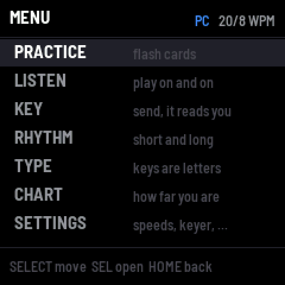 menu | 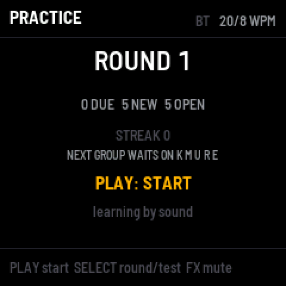 PRACTICE: start | 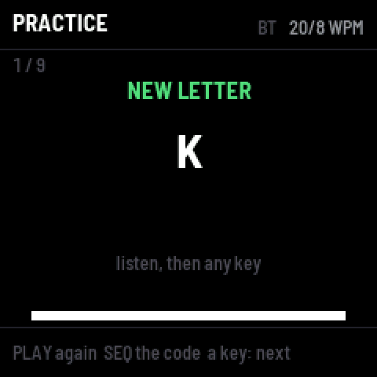 a new letter |
| 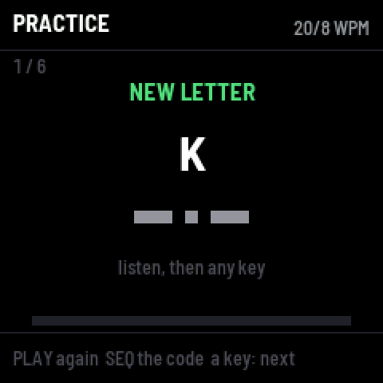 `SEQ`: a peek at its code | | |
| 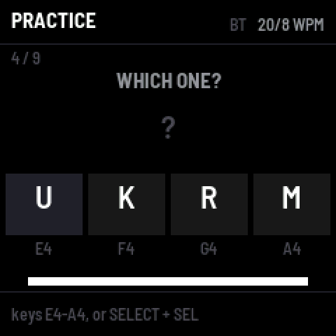 hear, pick one of four | 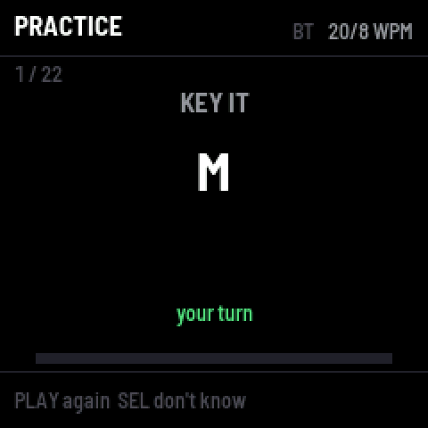 see it, key it | 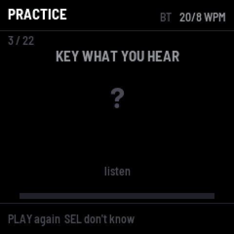 hear it, key it back |
| 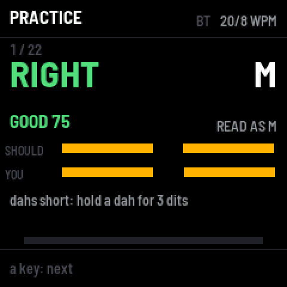 a keyed answer: right | 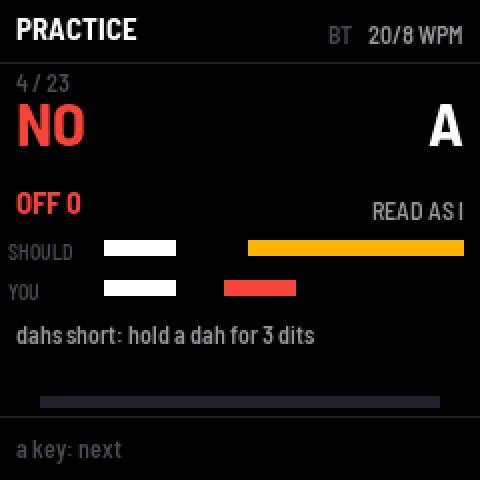 wrong: SHOULD over YOU | 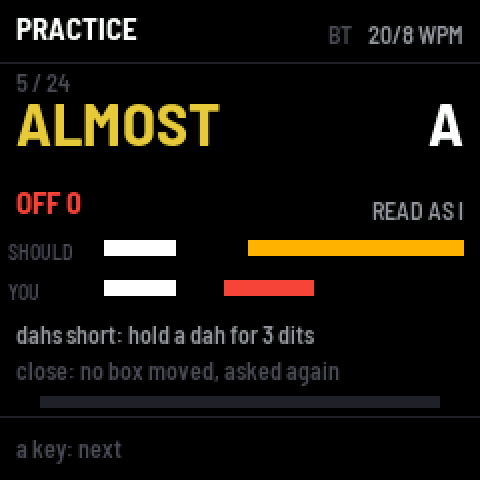 almost |
| 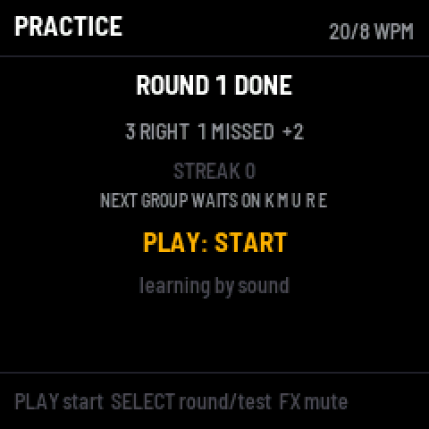 a round done | 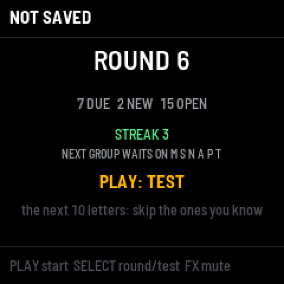 placement test | 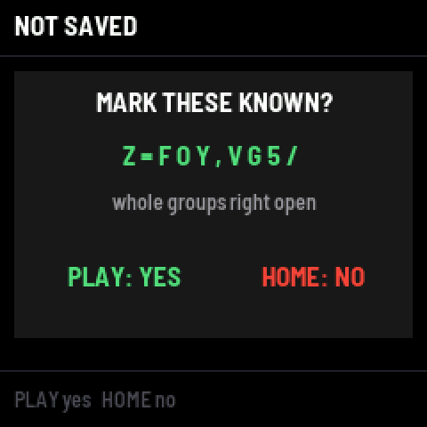 mark what you knew |
| 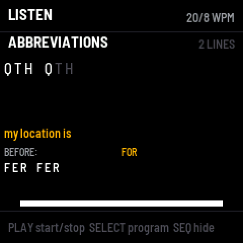 LISTEN | 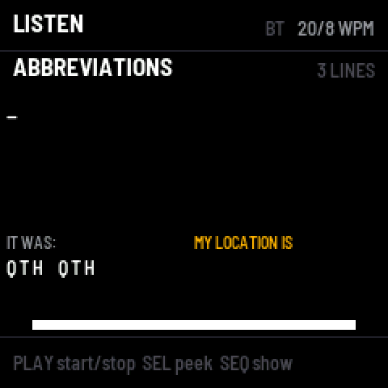 LISTEN, hidden | 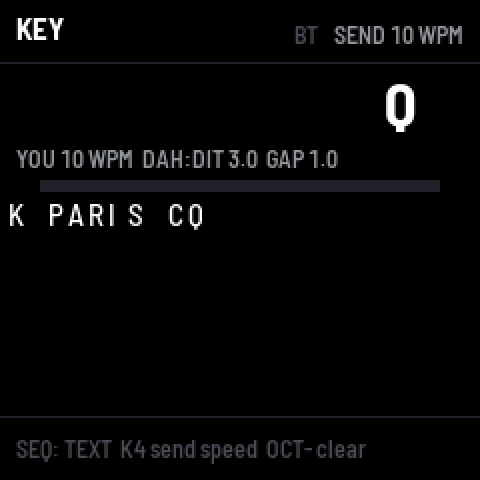 KEY: text |
|  KEY: code | 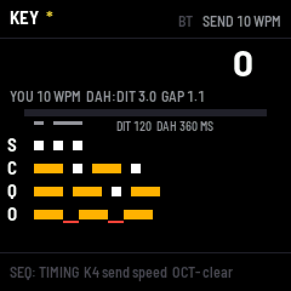 KEY: timing | 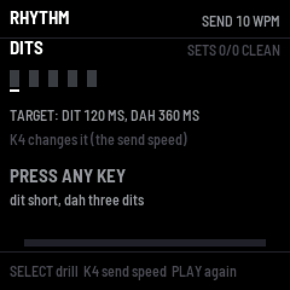 RHYTHM |
| 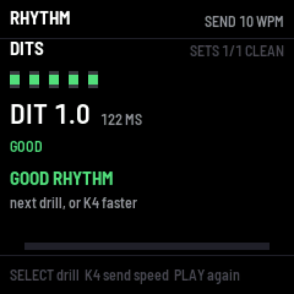 RHYTHM: even | 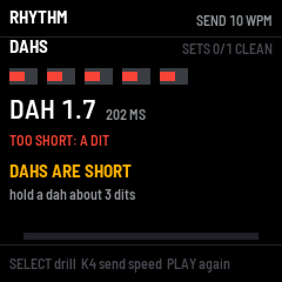 RHYTHM: dahs short | 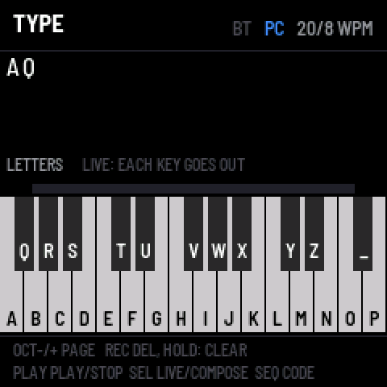 TYPE: letters |
| 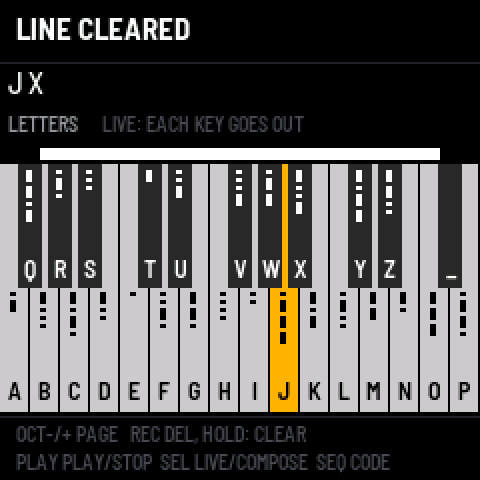 TYPE: the code on the keys | 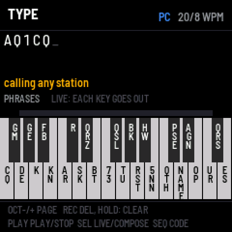 TYPE: phrases | 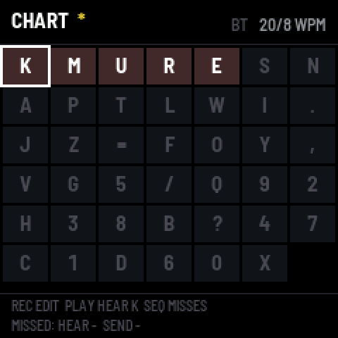 CHART |
| 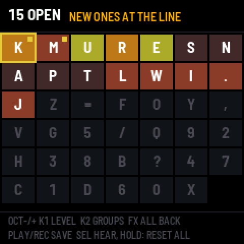 CHART: edit | 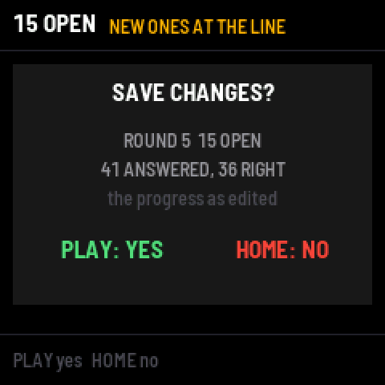 save? | 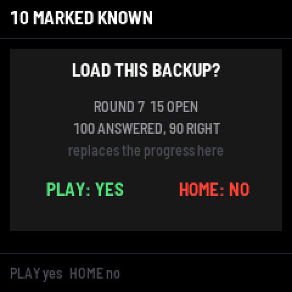 a backup to load |
| 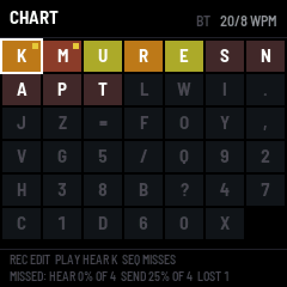 CHART: a letter's misses | 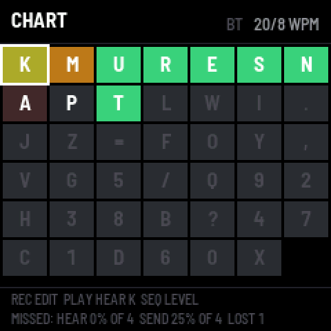 CHART by misses (`SEQ`) | |
| 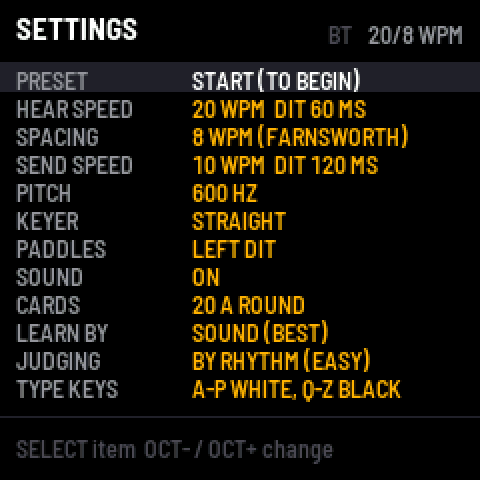 SETTINGS | 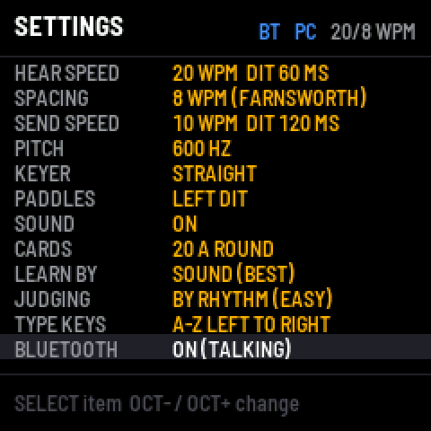 SETTINGS: BLUETOOTH, connected | 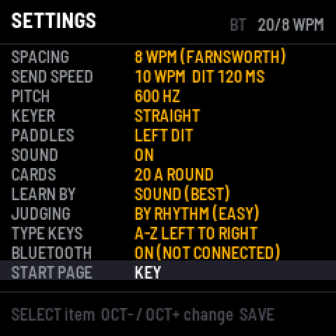 SETTINGS: START PAGE |
| 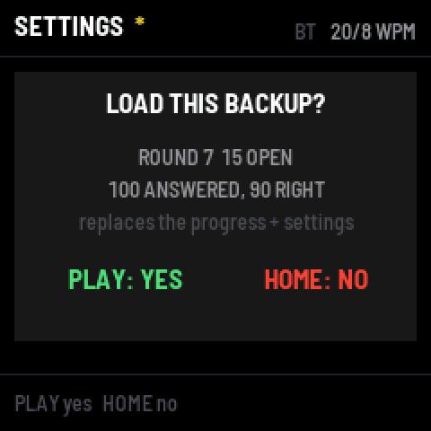 a backup with settings | 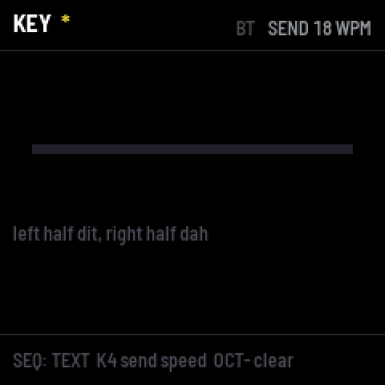 `*`: a setting not saved yet | |

## Install

Back up your FM-1's flash first ([M-Flasher](https://github.com/jvitkauskas/m-flasher)).

- From a release: download `morse-X.Y.fwsc` from
  [Releases](https://github.com/daviddwlee84/fm1-morse/releases) and install it with M-Flasher, or
  over USB-MIDI with fm1-base's `tools/fm1_install.py morse-X.Y.fwsc`.
- The package carries fm1-base's update loader, so another firmware can be installed from MORSE
  the usual way.
- Flash chips: the build saves to and updates on both the first FM-1s' (`856014`) and the newer
  ones' (`B36014`). Tested on a unit with the newer chip.

## Other firmwares' data

MORSE does not read other firmwares' projects or samples. It keeps one record, its settings and
progress (about 300 bytes), at `0xDA000`-`0xDBFFF`, written when a round ends and a few seconds
after a setting changes. On Felucca-family firmwares (SLOOP and others) that range is inside the
area for samples: if you keep many samples there, back up before switching. It writes nothing else
outside its own firmware area (nothing for Bluetooth), and does not touch the global settings at `0xFC000`. (An update to
another firmware, as with every fm1-base firmware, stages its loader at `0xE0000`.)

## Build

```sh
git clone --recursive https://github.com/daviddwlee84/fm1-morse
cd fm1-morse
python3 fm1-base/tools/build.py . --host          # the host simulator (see fm1-base's README for its tools)
cd build/host && ./morse_host ../../tests/basic.txt .
cc -Wall -Wextra -o /tmp/morse_test tests/morse_test.c && /tmp/morse_test   # the platform-free parts
python3 fm1-base/tools/build.py .                 # the device package (JieLi toolchain: fm1-base's README)
```

| File | What |
|---|---|
| `morse.c` | code table, PARIS / Farnsworth timing, text player with prosigns, iambic keyer, adaptive decoder, judging a keyed answer by its rhythm |
| `learn.c` | flash cards: Leitner boxes, rounds, Koch groups, the four choices, placement, edits by hand, the backup's bytes |
| `content.c` | what LISTEN plays and TYPE's phrases |
| `tone.c` | two sine voices with 5 ms ramps, mute |
| `app.c` | the pages, the 1 kHz tick (key, keyer, players, MIDI), storage, drawing |
| `common/` | hostlink (SysEx with a host over USB / BLE) and ledfx (LED patterns) |
| `tests/` | `morse_test.c` for the platform-free parts, `basic.txt` for fm1-base's host simulator |
| `web/` | `index.html` (MORSE on the web: live text both ways, back up / restore, over Web MIDI), `words/` (the screen reader's words) |
| `docs/` | `screen.png` (the Hub's card), `screens/` (this page) |

Development and the host program live in
[M-VAVE_FM-1](https://github.com/daviddwlee84/M-VAVE_FM-1), which has this repository as a
submodule.

## License

GPL-3.0-or-later (see `LICENSE`): you may share and change it, and what you build from it and
share must stay open too. Versions up to commit `57ea786` were published under MIT and stay
available under it.

- `common/` (hostlink, ledfx) is MIT, shared with other firmwares in
  [M-VAVE_FM-1](https://github.com/daviddwlee84/M-VAVE_FM-1).
- fm1-base, in `fm1-base/`, is MPL-2.0 (its files stay under it).
- The Koch order is LCWO's; the MIDI keying follows the Vail adapter's published format.
- Everything you hear is generated in code: no samples.
